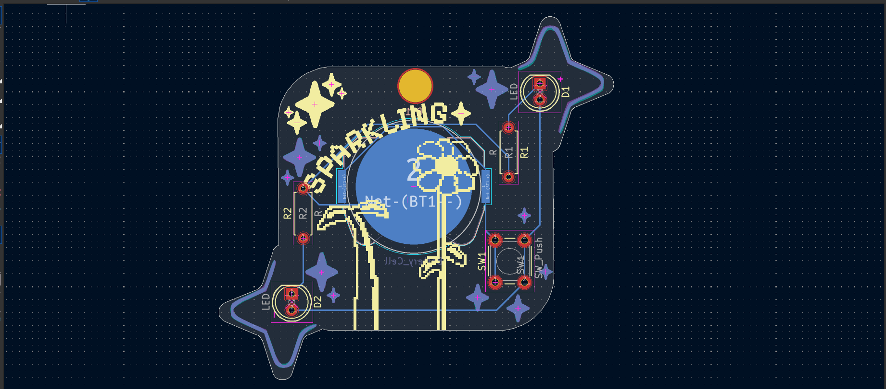

# A truly sparkling PCB
This a pcb made for the program "Solder" with a lot of stars in (there's a hole in the PCB so it can be uses as badge or a keychain ).

# PCB

# Schematic

# What does it do ?
* When the button is push, the the LEDs light up (yes, it's quite simple).

# Bill of materials  ?
* 2 LED
* 1 push button
* 1 batterie cell holder
* 2 resistors
