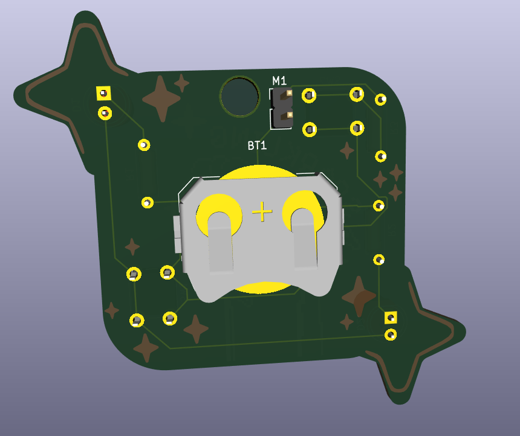
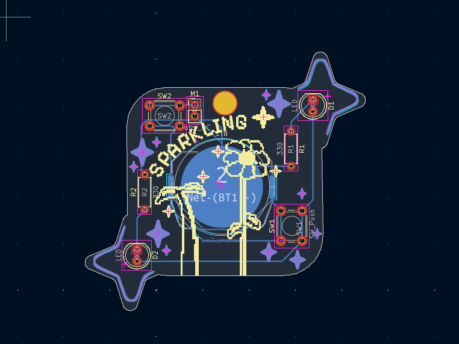
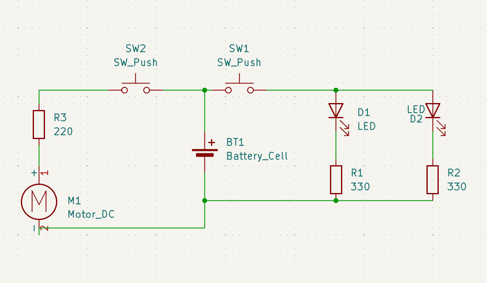

# A truly sparkling PCB
This a pcb made for the program ["Solder"](https://solder.hackclub.com/)) with a lot of stars in (there's a hole in the PCB so it can be uses as badge or a keychain ). I've followed the [tutorials](https://solder.hackclub.com/start) beacuse I've never made a pcb before 👍​.

# PCB

# Schematic

# What does it do ?
* When the button on the botton is push, the LEDs light up and if you push the second button, the motor will started to make vibration (yes, it's quite simple).

# Bill of materials  ?
* 2 LED
* 2 push button
* 1 batterie cell holder
* 2 resistors
* 1 vibration motor
  
Made by me @guissidaamira
