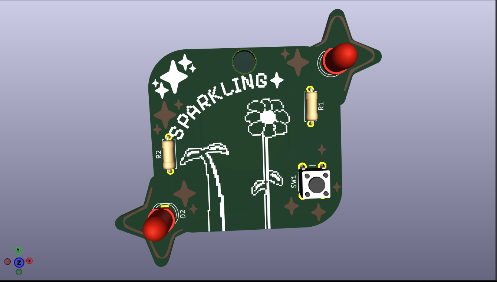
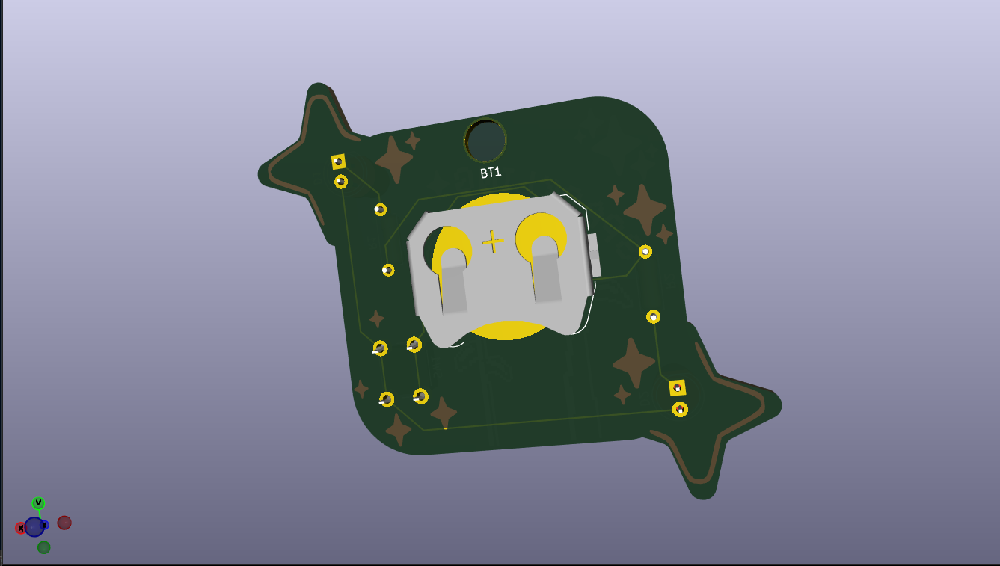
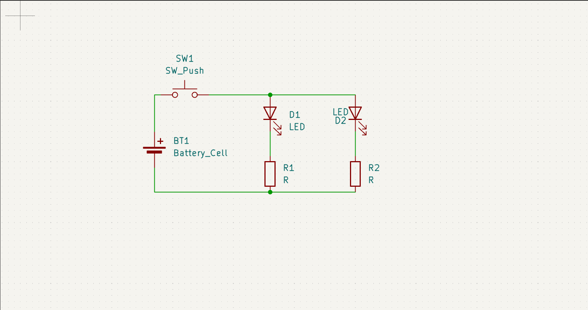

# A truly sparkling PCB
This a pcb made for the program "Solder" with a lot of stars in. If the PCB, when I push on the button, the led will emitted light.

# PCB

# Schematic

# What materials I used ?
 2 led
 1 push button
 1 batterie
 2 resistors
